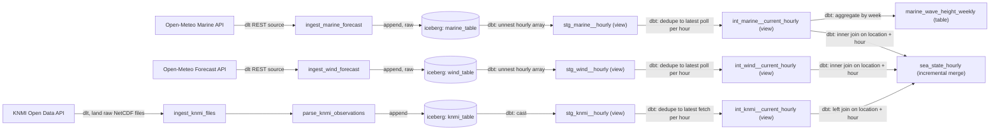

# dlt + dbt demo

A demo repo showing how to build data pipelines with [dlt](https://dlthub.com/) and
[dbt](https://www.getdbt.com/) on Databaas: dlt ingests public weather data into Iceberg,
and dbt (on Trino) shapes it into staging, intermediate and mart models, all orchestrated by
Airflow.

Three independently scheduled Sources feed one shared mart:

- **Marine**: Open-Meteo wave-height forecasts
- **Wind**: Open-Meteo wind speed/direction forecasts
- **KNMI**: observed wind at the same offshore point (Europlatform)



`stg_*__hourly` keeps one row per `(poll, hour)`: every poll appends a full 7-day forecast,
so an hour polled repeatedly has one staging row per poll. `int_*__current_hourly` collapses
that to one row per `(location, hour)`, keeping the latest poll's reading. Both marts read
this deduplicated layer rather than raw staging output, since a mart can't handle more than one
source row per key.

## What it does

- **`airflow/dags/marine_pipeline_dag.py`** defines the `marine_pipeline` DAG, scheduled
  hourly:
  1. **`ingest_marine_forecast`**: calls the Open-Meteo Marine API for a single location's
     7-day hourly wave-height forecast via dlt's `rest_api` source
     (`airflow/marine_pipeline/marine.py`), and appends the response untransformed to an
     Iceberg table (`airflow/marine_pipeline/lakehouse.py`). Each run adds one more row of
     history; nothing is overwritten.
  2. **`dbt`**: a Cosmos TaskGroup (see "dbt with Cosmos" below) that unnests the raw hourly
     payload (`stg_marine__hourly`), dedupes it to the latest poll per hour
     (`int_marine__current_hourly`), then aggregates wave height by ISO week per location
     (`marine_wave_height_weekly`). A final `transformed` task emits the Asset the Marts DAG
     triggers on.
- **`airflow/dags/wind_pipeline_dag.py`** defines the `wind_pipeline` DAG, on its own
  30-minute schedule, with the same two-task shape:
  1. **`ingest_wind_forecast`**: calls the Open-Meteo Forecast API for the same location's
     7-day hourly wind speed/direction forecast (`airflow/wind_pipeline/wind.py`) and appends
     it raw to its own Iceberg table (`airflow/wind_pipeline/lakehouse.py`).
  2. **`dbt_run`**: unnests the raw hourly payload into one row per hour
     (`stg_wind__hourly`) and emits an Asset on success.
- **`airflow/dags/knmi_pipeline_dag.py`** defines the `knmi_pipeline` DAG, scheduled daily
  (KNMI publishes this dataset's files once a night). It demonstrates dlt's "ingest as a
  file" pattern:
  1. **`ingest_knmi_files`**: lists the most recent hourly observation files and lands the
     raw NetCDF bytes in object storage (`airflow/knmi_pipeline/knmi.py`,
     `airflow/knmi_pipeline/lakehouse.py`).
  2. **`parse_knmi_observations`**: reads each landed file back, extracts the station's
     reading (`airflow/knmi_pipeline/parsing.py`) and appends it to an Iceberg table.
  3. **`dbt_run`**: casts the parsed rows into `stg_knmi__hourly` and emits an Asset.
- **`airflow/dags/marts_pipeline_dag.py`** defines the `marts_pipeline` DAG: the shared Marts
  DAG, with no ingestion of its own. Its single **`dbt_run`** task builds `sea_state_hourly`
  (`airflow/dbt/models/marts/sea_state_hourly.sql`): marine and wind inner-joined on
  `(location, forecast_time)`, with KNMI's observation left-joined on, so observed columns are
  NULL until KNMI has published that hour. It is `materialized='incremental'` with
  `incremental_strategy='merge'`, so a repeated poll of a forecast hour updates it in place.
  It's scheduled on the OR of the three Sources' Assets, plus a daily fallback so a stalled
  Source doesn't stop it from running.

Tasks run in KubernetesExecutor pods on the Databaas Airflow runtime image, which ships dlt,
dbt-core/dbt-trino, pyiceberg and databaas-utils,
so they are plain `@task`s. The exception is `parse_knmi_observations`: netCDF4 isn't in the
image, so it is a `@task.virtualenv` that adds only that package on top of the image's own.

Every task reaches the lakehouse as one Zitadel service account, through the
`databaas_lakehouse` Airflow connection (`databaas_utils.airflow`). Iceberg tables and generic
tables go through Lakekeeper, which signs each S3 request, so no S3 keys are configured
anywhere. dbt authenticates to Trino with the same service account's token.

## Layout

```
airflow/
  dags/marine_pipeline_dag.py   # marine Source DAG: ingest -> dbt (Cosmos) -> transformed (emits an Asset)
  dags/wind_pipeline_dag.py     # wind Source DAG: ingest -> dbt_run (emits an Asset)
  dags/knmi_pipeline_dag.py     # KNMI Source DAG: land files -> parse -> dbt_run (emits an Asset)
  dags/marts_pipeline_dag.py    # shared Marts DAG: dbt_run only, triggered by any Source's Asset
  marine_pipeline/              # marine Source: dlt source, location config, lakehouse write
  wind_pipeline/                # wind Source: dlt source, location config, lakehouse write
  knmi_pipeline/                # KNMI Source: file listing/download, NetCDF parsing, lakehouse write
  dbt/                          # dbt project: staging, intermediate and mart models, profile, config
  dbt_cosmos/                   # Cosmos TaskGroup factory + Trino JWT profile mapping
  pyproject.toml                # packages this bundle exposes to its own tasks
tests/                          # unit tests, outside the deployed bundle
pyproject.toml                  # dev-only tooling (pytest and friends)
```

## Configuration

- **Location** is a single hardcoded point per Source (`airflow/*_pipeline/models.py`, the
  same offshore point in all three), not a loop over a list. Add a second `Location`
  constant and a second call site if a second location is ever needed.
- **Namespacing** is deployment-scoped: `databaas_utils.airflow.scoped()` turns
  `marine_forecast`/`wind_forecast`/`knmi_observation` into `..._dev_<branch>` on a branch
  deploy, so `dev` and `prod` never collide. Each DAG's dbt task derives its source
  schema/table names directly from its own `lakehouse` module at run time rather than
  duplicating them in `airflow/dbt/models/staging/sources.yml`.
- **Lakehouse connection**: `databaas_lakehouse`, of the "DataBaas Lakehouse" connection type
  databaas-utils registers. Host is the Lakekeeper server root (not `/catalog`), schema the
  warehouse, login/password the Zitadel service account's client id/secret, and the extras
  carry `token_url` and `project_id`. The account needs Lakekeeper grants on every
  namespace these DAGs write, and the connection's **Test** button checks the whole chain.
- **KNMI connection**: `KNMI_REGISTERED_API_KEY`, a Generic Airflow connection holding the
  registered KNMI Data Platform API key as its password.
- **Trino connection** defaults live in `airflow/dbt/profiles.yml`: JWT over HTTPS to
  `trino.example.databaas.app:443`, overridable via `TRINO_HOST`/`DBT_TRINO_PORT`/
  `TRINO_CATALOG`. Each `dbt_run` task sets `TRINO_JWT` from the lakehouse connection;
  a local run sets it by hand (`databaas token`).

## dbt with Cosmos

`dbt_cosmos.dbt_task_group()` renders a dbt selection as a Cosmos TaskGroup in **watcher
mode**: one producer task runs a single `dbt build` for the selection, and each model and
test gets a deferrable sensor that reports its own result, so the UI shows per-node status
and logs without a pod and a dbt parse per node.

- **The graph comes from `airflow/dbt/target/manifest.json`**, which must be generated with
  `dbt parse` (with `TRINO_JWT` set to anything) before the DAGs are deployed or parsed
  locally. It isn't committed. The dag-processor has Cosmos but no dbt, so Cosmos never runs
  `dbt ls` there.
- **Trino auth** is `LakehouseTrinoJWTProfileMapping`: Cosmos writes the dbt profile inside
  the task pod, and the mapping fetches the lakehouse connection's token there. Only an
  `env_var()` placeholder reaches the profile file.
- **Assets:** Cosmos's per-model asset emission is off (`emit_datasets=False`); each DAG
  emits its own Asset from a final task.

## Testing

Unit tests live under `tests/` at the repo root, outside `airflow/` (so they never
end up in the deployed bundle). They cover the marine and wind Sources' dlt fetch functions
with the underlying HTTP client mocked, so no real calls reach upstream APIs. Run them with:

```
uv run --group dev pytest
```

`pytest`, `responses` (HTTP mocking), and `dlt` are dev-only dependencies declared
in the root `pyproject.toml`'s `dev` group, separate from `airflow/pyproject.toml`.
